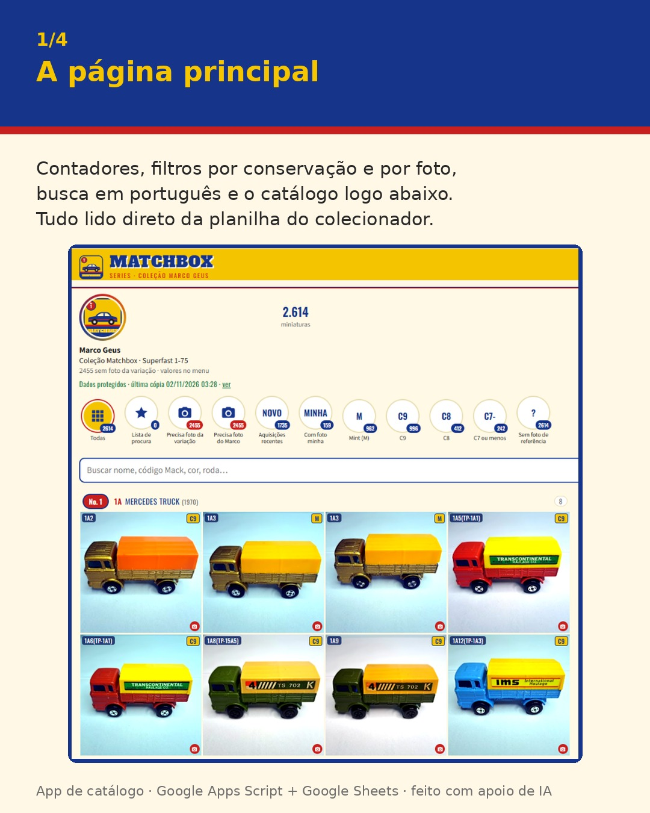
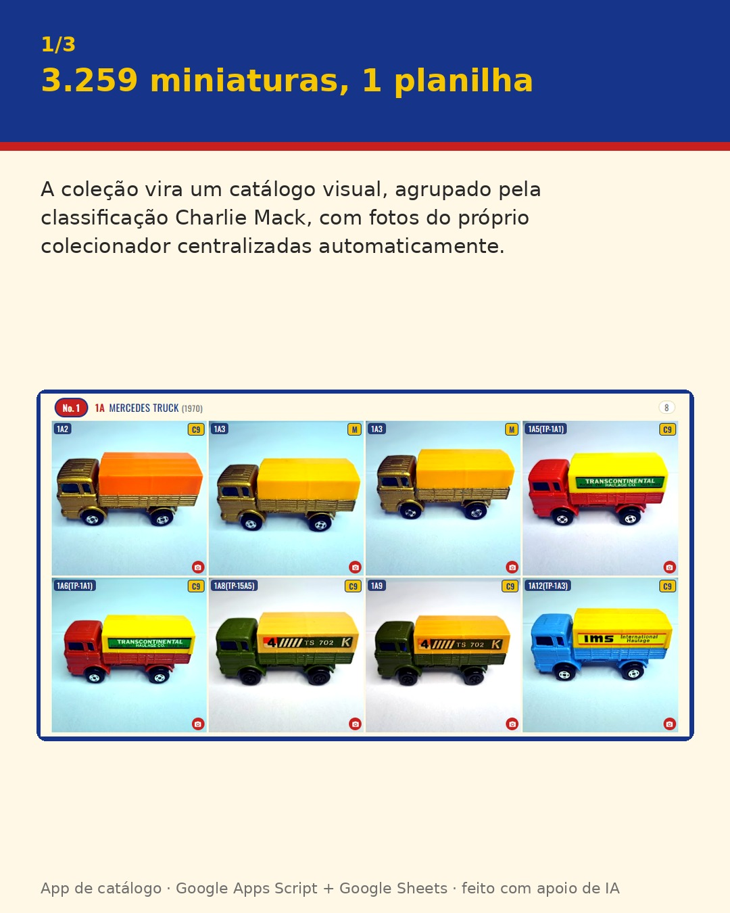
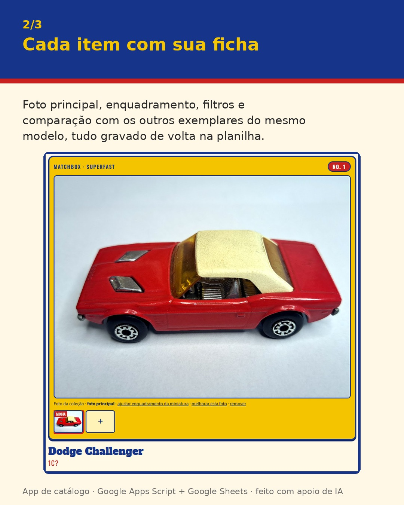
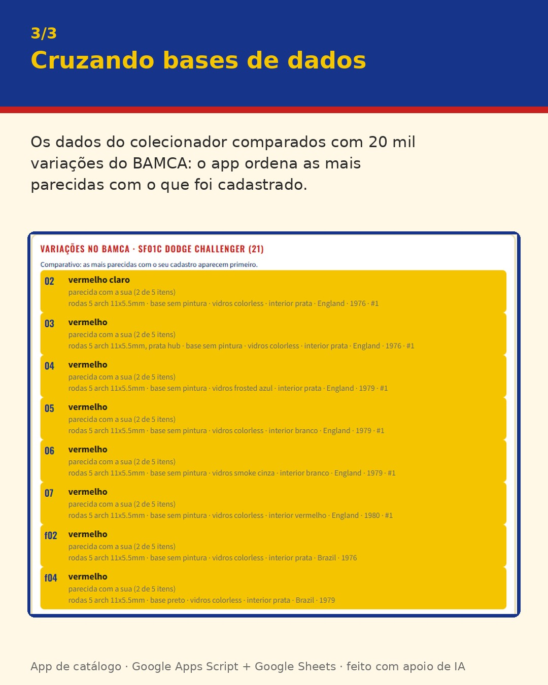

# Matchbox · Coleção Marco Geus

App de celular para catalogar uma coleção real de **3.259 miniaturas Matchbox** (645 Lesney de rodas regulares, 1953–1969, e 2.614 Superfast, 1969–1982), usando uma planilha do Google como banco de dados.

Projeto pessoal, sem fins comerciais, construído com Google Apps Script e com IA (Claude) como parceira de desenvolvimento.

| Página principal | Catálogo | Ficha do item | Cruzamento com o BAMCA |
|---|---|---|---|
|  |  |  |  |

---

## O problema

A coleção vivia numa planilha com anos de história: colunas sem cabeçalho, duas classificações que deveriam concordar e não concordavam, e nenhuma foto. A ideia era que o colecionador (60+, pouca intimidade com tecnologia) pudesse consultar, fotografar e cadastrar pelo celular, **sem que a planilha deixasse de ser a fonte da verdade**.

## A parte de dados (a mais divertida)

- **Fonte da verdade.** A classificação Charlie Mack aparecia em duas colunas que divergiam em 535 itens (7 deles com modelo diferente). Foi preciso decidir qual coluna manda e rebaixar a outra a referência histórica.
- **Cruzamento com base externa.** Importação única do dump SQL do [BAMCA](https://www.bamca.org) (≈20 mil variações), com autorização do mantenedor. As chaves não batem diretamente: Regular Wheels seguem o código Mack (RW01a = 1A); Superfast passa por uma tabela de aliases. O app ordena as variações mais parecidas com o cadastro.
- **Auditoria de qualidade.** Uma conferência mostrou que 81% das fotos de referência de uma série estavam associadas ao modelo errado: quando um número tinha uma única página na fonte, ela era usada para todos os modelos daquele número. A regra passou a exigir correspondência de nome.
- **Busca em português sobre dados em inglês.** Sinônimos, frases ("carro de bombeiro" → fire engine), palavras de ligação ignoradas e traduções que só casam com palavra inteira (para "fire" não trazer "Firebird").
- **Integridade.** IDs únicos por linha, conferência semanal automática, backup diário em rodízio de 7 cópias e restauração pelo próprio app.

## Funcionalidades

- Catálogo em grade, agrupado por modelo Mack, com filtros por conservação, foto e aquisições recentes.
- Ficha com foto principal, enquadramento automático da miniatura (detecção do objeto contra o fundo), filtros de imagem e comparação com os outros exemplares do modelo.
- Cadastro com campos sugeridos a partir de itens parecidos; o que for alterado fica marcado como "alterado manualmente".
- Reconhecimento por foto (Gemini), com busca por cor como alternativa quando o serviço demora.
- Lista de procura para feiras, valores da coleção, exportação de uma cópia limpa para Excel.

## Arquitetura

```
Google Sheets (abas Lesney e Superfast)  ← fonte da verdade
        │
Apps Script (src/Codigo.gs, src/Referencia.gs)   ← leitura, gravação com lock, backups, importações
        │
Web app (src/Index.html + Styles.html + App.html) ← interface mobile, HTML/CSS/JS puro
        │
Planilha de referência separada (Charlie Mack + BAMCA) e pastas no Drive (fotos, backups, exportações)
```

Decisão consciente: **planilha em vez de banco SQL**. O colecionador consegue ver e corrigir os dados, o Google guarda histórico de versões e não há servidor para manter.

## Como usar

1. Crie uma planilha com as abas `Lesney` e `Superfast` no layout esperado (ver `SCHEMA` em `src/Codigo.gs`).
2. Em Extensões > Apps Script, adicione `Codigo.gs`, `Referencia.gs` e o `Index.html` gerado por `python3 build.py` (arquivo `dist/Index.html`).
3. Rode `instalar()` pelo menu da planilha e implante como app da Web.
4. Opcional: chave do Google AI Studio pelo menu "Configurar reconhecimento por foto".

Os dados da coleção, as fotos e a cópia do BAMCA **não** fazem parte deste repositório.

## Créditos

- Classificação: Charlie Mack (lista via fcarnahan.com).
- Variações: BAMCA, de Dean Dierschow, usadas com autorização para uso privado.
- Coleção e paciência infinita: Marco Geus.
